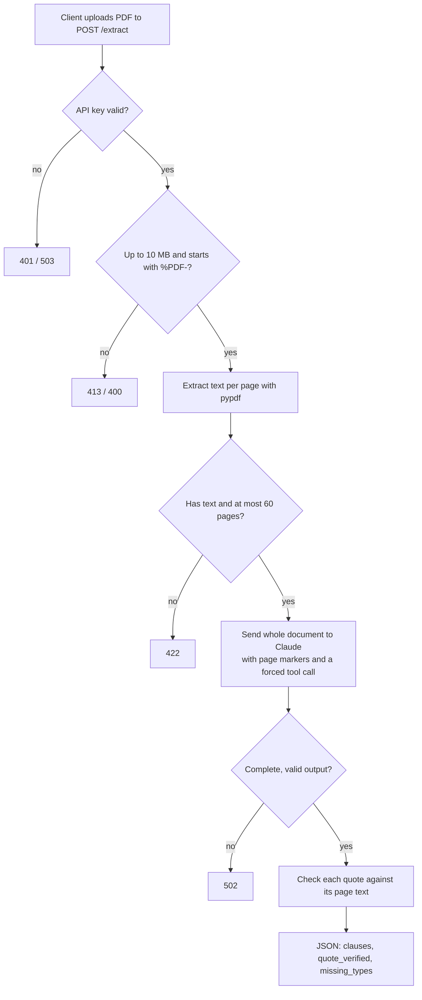

# Contract Clause Extractor

[](https://github.com/Sunil786Kumar/clause-extractor/actions/workflows/ci.yml)

A small HTTP API that takes a contract as a PDF and returns its termination, liability, payment and renewal clauses as JSON. Each clause comes with a plain-English summary, the page it appears on, and a short quote from the contract. The service checks every quote against the text of that page and reports whether it was found. It is meant for people who review contracts, such as legal or procurement teams, who want to find the key clauses quickly and check each one against the source document. It is built with FastAPI and Claude (`claude-haiku-5-5`).

## Live demo

Interactive API docs: **https://clause-extractor-x79f.onrender.com/docs**

- `/extract` needs an API key, sent in the `X-API-Key` header. The demo key isn't published. Ask me if you'd like one. `/health` needs no key.
- The demo runs on a free Render instance, which sleeps after 15 minutes without traffic. If it has been idle, the first request takes about a minute while it starts up. Later requests are fast.

## How it works



1. The upload is checked for size (10 MB maximum) and the `%PDF-` file signature.
2. pypdf extracts the text of each page. Each page is labelled with a `[Page N]` marker so Claude can cite pages.
3. Claude is called with a single tool, `save_clauses`, and `tool_choice` forces it to use that tool. The tool's input schema is generated from a Pydantic model, so the output has a fixed structure: type, title, summary, page and quote for each clause.
4. The tool input is validated against the same Pydantic model.
5. Each quote is normalised (case, whitespace, curly quotes) and checked against the normalised text of the page Claude cited. The result is returned as `quote_verified`.
6. Clause types that weren't found are listed in `missing_types`, so "no renewal clause" is stated in the response rather than left for the reader to infer.

### Why the whole document instead of RAG

Contracts within the page limit fit easily in the model's context window, so there is nothing to gain from splitting them into chunks and retrieving a few. Retrieval would also add a way to fail: a clause the retriever doesn't pick up can't be extracted, and nothing in the response would show it was missed. Clauses also refer to each other ("subject to clause 12", definitions on an earlier page), and the model can only follow those references if it has the whole text. Sending everything keeps the system simpler, with no embeddings, vector store or chunking choices to tune. The cost is a 60-page limit. See [Known limitations](#known-limitations-and-next-steps).

### Why quotes are verified

A reviewer will rely on the page reference and quote to find the clause in the original document, so they need to be correct. Language models can paraphrase while presenting the result as a quote, or cite the wrong page. The service checks each quote against the extracted text of the cited page and returns `quote_verified: false` when it isn't there. The clause is kept, not dropped, so the reviewer can decide what to do with it, but the flag tells them to check it by hand.

## Example

```bash
curl -X POST https://clause-extractor-x79f.onrender.com/extract \
  -H "X-API-Key: YOUR_API_KEY" \
  -F "file=@tenancy-agreement.pdf"
```

Sample response (shortened):

```json
{
  "document": "tenancy-agreement.pdf",
  "pages": 12,
  "model": "claude-haiku-5-5",
  "clauses": [
    {
      "type": "payment",
      "title": "Clause 4 Rent",
      "summary": "The tenant pays rent every fortnight, in advance, by bank transfer.",
      "page": 3,
      "quote": "The tenant must pay rent in advance every fortnight.",
      "quote_verified": true
    },
    {
      "type": "renewal",
      "title": "Clause 6 Continuation of fixed term agreement",
      "summary": "If neither party gives notice, the agreement continues as a periodic agreement after the fixed term ends.",
      "page": 4,
      "quote": "this agreement continues as a periodic agreement",
      "quote_verified": true
    }
  ],
  "missing_types": ["liability"]
}
```

## Error responses

Errors return JSON in FastAPI's usual form, `{"detail": "..."}`.

| Status | Meaning |
| --- | --- |
| 400 | The file is not a PDF (it doesn't start with the `%PDF-` signature). |
| 401 | The `X-API-Key` header is missing or wrong. |
| 413 | The file is larger than 10 MB. |
| 422 | The PDF can't be processed: it has no extractable text (probably a scanned image that needs OCR) or more than 60 pages. FastAPI also returns 422 when the `file` field is missing. |
| 502 | The AI service failed: the Anthropic API returned an error or couldn't be reached, Claude's output was cut off at the token limit, or its output didn't match the expected schema. |
| 503 | The service has no `SERVICE_API_KEY` configured, so it refuses every `/extract` request. |

## Engineering decisions

- **Truncated or invalid AI output fails loudly.** If Claude stops because it hit `max_tokens`, the request fails instead of returning a partial list that would look complete. Tool output is validated against the Pydantic schema, and a mismatch is an error, not something to be patched over.
- **Errors separate user faults from AI-service faults.** Problems with the upload return 4xx with a specific message. Problems with the Anthropic API or the model's output return 502. Validation details from the model's output are not included in the response, so internal details don't leak to the client.
- **The API key check fails closed.** If `SERVICE_API_KEY` is unset or empty, `/extract` returns 503 rather than running without authentication. The key is compared with `secrets.compare_digest` to avoid timing differences. `/health` stays open for the hosting platform's health checks.
- **The Docker image is small and contains no secrets.** It is built on `python:3.15-slim` and installs only runtime dependencies from the lockfile with a pinned uv version. It runs as a non-root user. `.env` and tests are excluded by `.dockerignore`, and keys are supplied as environment variables at runtime.
- **Tests use a fake Claude client.** The Anthropic client is a FastAPI dependency, so tests replace it with a fake that returns preset tool calls or raises errors. Tests generate small PDFs with reportlab. They cover quote verification, missing types, truncation, invalid output, API errors, auth (missing, wrong, non-ASCII and unconfigured keys), size and type checks, and temp-file cleanup. No API key or network access is needed.
- **CI runs on GitHub Actions.** Every push and pull request runs the test suite and builds the Docker image.

## Run locally

Requires [uv](https://docs.astral.sh/uv/). uv installs the Python version listed in `.python-version` (3.15).

```bash
uv sync
```

Set these environment variables, or put them in a `.env` file, which is git-ignored:

- `ANTHROPIC_API_KEY`: used by the Anthropic client
- `SERVICE_API_KEY`: the key clients must send in `X-API-Key`

Start the API (docs at http://localhost:8000/docs):

```bash
uv run uvicorn app:app --reload
```

Or run an extraction from the command line:

```bash
uv run python extractor.py path/to/contract.pdf
```

Run the tests:

```bash
uv run pytest
```

Docker:

```bash
docker build -t clause-extractor .
docker run --rm -p 8000:8000 \
  -e ANTHROPIC_API_KEY -e SERVICE_API_KEY \
  clause-extractor
```

## Known limitations and next steps

- **Uploads are received before the key check.** FastAPI reads the multipart body before the auth dependency runs, so an unauthenticated client can still send a file and use bandwidth before getting a 401. The next step is to check the header in middleware, or at a reverse proxy, before the body is read.
- **60-page limit.** Sending the whole document puts a cap on its length. Longer contracts would need splitting with clause-aware boundaries, or a retrieval step.
- **Single free instance.** There is no scaling, rate limiting or uptime guarantee, and the first request after the instance has been idle is slow. Extraction runs synchronously within the request.
- **Boundaries between clause types can be ambiguous.** A "continuation of fixed term" clause could reasonably be classed as renewal or termination, and the model doesn't always choose the same way. More precise type definitions and examples in the prompt would help.
- **No evals yet against real contracts.** The tests check the service's behaviour, not extraction quality. The next step is a labelled set of real contracts, with precision and recall measured for each clause type and the quote verification rate tracked.
- **Text-based PDFs only.** Scanned documents are rejected with a 422. Adding OCR would cover them.
